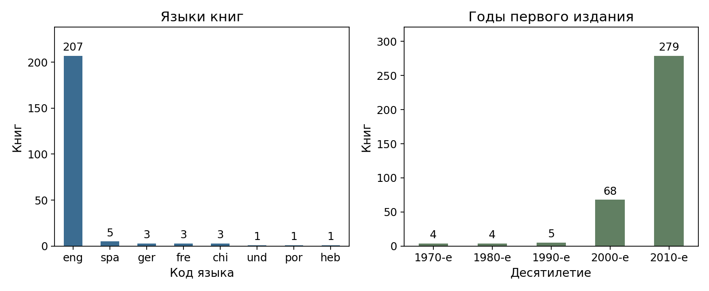
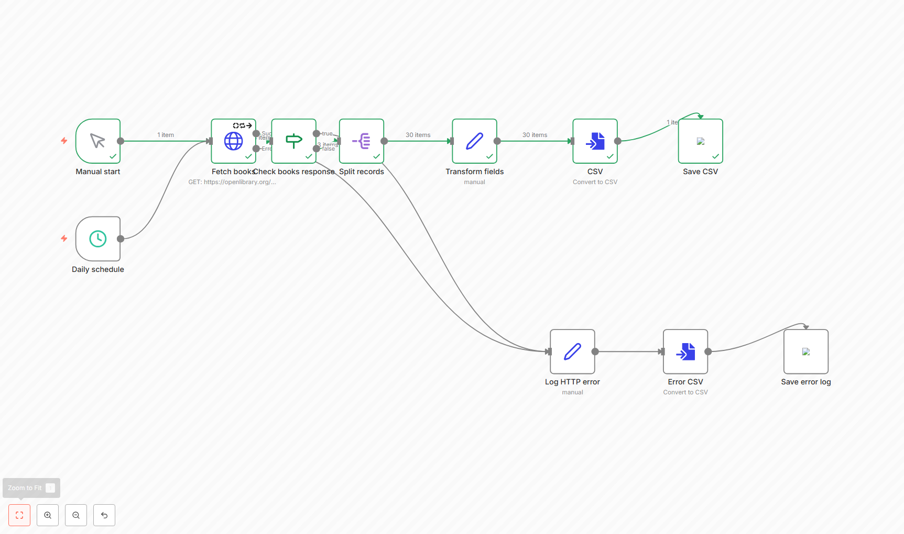
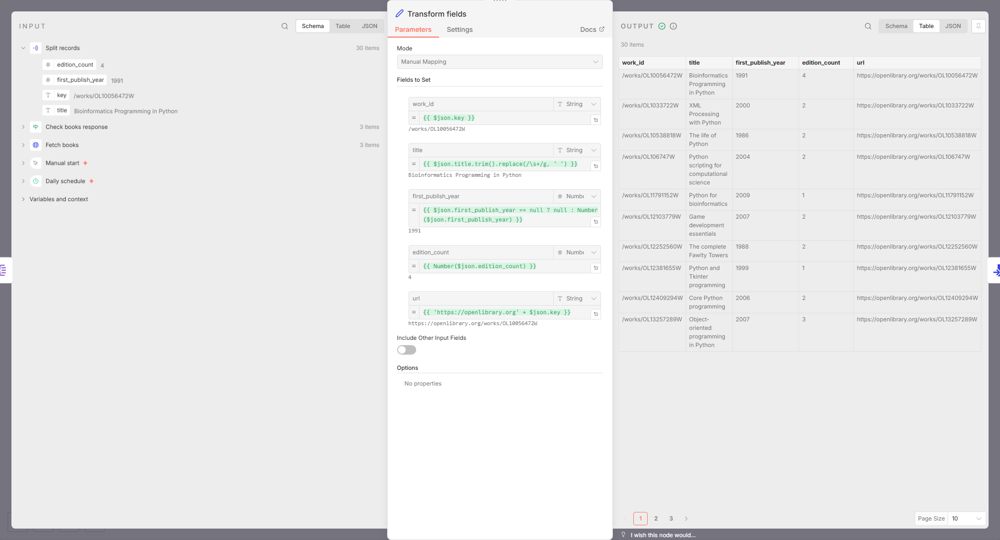

# Лабораторная 3. Сбор данных через REST API

## 1. Цель и вариант

Вариант 3: Open Library Search и Open Library Authors. Задача - получить книги по теме, добавить сведения об авторах и проанализировать годы издания, языки и полноту данных.
В сохранённом наборе по запросу `python programming` находятся 360 книг. Все приведённые ниже показатели относятся к этому набору; новый запуск может найти дополнительные ключи. Минимум задания - 300 записей и три страницы. В n8n сохранены 30 книг при минимуме 20.

## 2. Паспорт API

| Параметр | Значение |
|---|---|
| Название и базовый URL | Open Library, https://openlibrary.org |
| Эндпоинты | `/search.json` - поиск книг; `/authors/ID.json` - сведения об авторе |
| Версия | В URL не указана |
| Метод и формат | GET, ответ JSON |
| Авторизация | Публичные запросы, API-ключ не требуется |
| Параметры поиска | q, offset, limit, fields, sort; в работе sort=key |
| Пагинация | offset - смещение, limit - размер порции |
| Документированный лимит | Без контакта в User-Agent - 1 запрос/с, то есть 60 запросов/мин |
| Заголовки | User-Agent и Accept в запросе; проверка Content-Type в ответе; Retry-After учитывается при наличии |
| Заголовки лимитов | RateLimit-* и X-RateLimit-* сохраняются, если пришли; в примере их нет |
| Время | Год издания - число; время сбора и изменения автора приводится к datetime в UTC |
| Ключи | key книги (`work_id`) и ключ автора (`author_key`) |
| Персональные сведения | Имена авторов; контакты, адреса и биографии в файлы не сохраняются |
| Условия использования | Небольшая учебная выборка, паузы и кэш. Для массового каталога Open Library рекомендует выгрузки данных |

## 3. Архитектура сбора

**Источник → сбор → нормализация → проверка → хранение.**
Search API и Authors API → GET-запросы через requests.Session → таблица книг, отдельная таблица языков и присоединение авторов → проверки полноты, ключей и значений → JSONL, CSV, журнал и состояние.
Код находится в [collect.py](collect.py). Исходные записи книг сохраняются в [data_raw.jsonl](data_raw.jsonl), итоговая таблица - в [data_clean.csv](data_clean.csv). Сведения Authors API кэшируются в authors_cache.json.

## 4. Пагинация, лимиты и повторы

Python получает четыре порции по 90 книг: offset 0, 90, 180, 270. Функция paginate принимает page_size, max_records и max_pages. Смещение увеличивается на фактическое число записей. Остановка - пустая порция, достижение общего числа найденных книг, лимит 360 записей или 20 страниц.

Между запросами выдерживается 1,1 секунды; timeout - 20 секунд. User-Agent обозначает программу, Accept=application/json задаёт ожидаемый формат. Проверяются HTTP-статус, Content-Type и структура JSON. Ошибка содержит первые 200 байт тела ответа.

Повторяются только HTTP 429 и 5xx, не более двух раз после первой попытки. Задержка растёт, добавляется случайная часть; Retry-After задаёт нижнюю границу ожидания. Остальные 4xx и сетевые ошибки записываются в журнал и прерывают сбор.

[collection_log.csv](collection_log.csv) содержит страницу, URL, параметры, статус, число записей, длительность и время запроса. [headers_example.json](headers_example.json) содержит настоящий ответ HTTP 200 с Content-Type application/json; команда `python collect.py --show-headers` обновляет этот пример одним запросом.

## 5. Проверка качества и анализ данных

JSON преобразован через pandas.json_normalize с sep. Массив language развёрнут через record_path и meta: получены 225 связей в [book_languages.csv](book_languages.csv).
Для каждого произведения используются сведения первого автора. Общее число авторов сохранено отдельно. Объединение по author_key выполнено с проверкой many_to_one: до и после него 360 книг, сведения автора найдены для 357. Числа приведены к numeric, временные поля - к datetime с UTC.

| Поле | Полнота, % |
|---|---:|
| work_id | 100.00 |
| title | 100.00 |
| first_publish_year | 100.00 |
| edition_count | 100.00 |
| author_key | 99.17 |
| author_name_catalogue | 99.17 |
| author_count | 100.00 |
| language_count | 100.00 |
| languages | 60.00 |
| collected_at | 100.00 |
| url | 100.00 |
| author_name_verified | 99.17 |
| author_revision | 99.17 |
| author_modified_at | 99.17 |
| author_url | 99.17 |
| author_matched | 100.00 |

Уникальных ключей - 360; дублей и пустых обязательных полей - 0. Проверены положительное число изданий, год не позже текущего, формат work_id и непустое название. Нарушений нет. Результаты сохранены в quality.json и completeness.csv. Целые поля имеют nullable-тип Int64, collected_at и author_modified_at — datetime с UTC.

По правилу 1,5 IQR отмечены 11 необычных лет издания и 50 значений числа изданий. Границы: 1998–2030 и −0,5–3,5 соответственно. Это статистические кандидаты на проверку, а не ошибки: старые книги и несколько изданий допустимы. Строки не удалялись; результат — outliers.json.
Годы первого издания: от 1975 до 2019; медиана - 2013, среднее - 2012,49. В 2010-е впервые опубликованы 279 из 360 книг. Языки указаны у 216 книг; английский есть у 207. Это первые 360 результатов, отсортированных по ключу, поэтому выводы относятся только к этой выборке.

## 6. No-code сценарий в n8n

Manual start или Daily schedule → Fetch books → Check books response → Split records → Transform fields → CSV → Save CSV. Расписание настроено на ежедневный запуск.
Fetch books получает три порции по 10 книг: offset 0, 10, 20. Между запросами пауза 1,1 секунды, timeout - 25 секунд. Transform fields переименовывает key в work_id, очищает название, приводит год и число изданий к числам и строит URL.
Настроены повторы сетевого узла и отдельная ветка Log HTTP error → Error CSV → Save error log. В сохранённой проверке эта ветка сформировала журнал ошибки. В [workflow.json](nocode/workflow.json) сохранены настройки сценария.
Получены 30 книг в [nocode_result.csv](nocode/nocode_result.csv). Все пять общих полей совпадают с Python: work_id, title, first_publish_year, edition_count, url. Запросов к Authors API в n8n нет: это упрощённый сценарий.

## 7. Сравнение подходов и вывод

| Показатель | Python | n8n |
|---|---:|---:|
| Разработка до первой выгрузки, мин | 5.88 | 0.65 |
| Число записей | 360 | 30 |
| Время первого прогона, с | 348.81 | 13.34 |
| HTTP-запросы | 310 | 3 |
| Тела ответов, КБ (1000 байт) | 180.55 | 3.88 |
| Пагинация | Функция с лимитами | HTTP Request, три порции |
| Обработка ошибок | Проверки, повторы, журнал | Повторы, проверка ответа, ветка ошибки |
| Повторный запуск | Только новые ключи | Повторная запись CSV |
| Воспроизводимость | Код, notebook, Git | Экспорт JSON, Git |
| Плата сервисам при 100 запусках, руб. | 0 | 0 |
| Порог входа, 1-5, субъективно | 4 | 2 |

Замер подготовки включает получение первой выгрузки, но не предварительное планирование и установку окружения. Поэтому он не равен полному времени разработки. Для сборов использованы готовые учебные шаблоны. Основание цифр - development_metrics.json, metrics_initial.json и nocode/metrics.json.
Python собирает больше книг и добавляет авторов, поэтому полное время нельзя сравнивать напрямую. Повтор Python занял 8,67 секунды и сделал четыре запроса. Платных API и облачного n8n нет; стоимость электричества, оборудования и сопровождения не оценивалась.
[state.json](state.json) хранит известные ключи и watermark - смещение и последний ключ завершённого сбора. Повторный запуск снова проверяет четыре порции и добавляет только новые ключи. В сохранённом повторе новых записей 0, CSV не изменился. Кэш позволил не повторять запросы к 306 авторам.

Python выбран для полной таблицы, анализа и повторного сбора. n8n удобен для небольшой выгрузки по расписанию. В совместном варианте Python собирает и проверяет данные, n8n запускает его по расписанию и сообщает об ошибках.

## 8. Правовая и этическая оценка

Open Library публикует каталог и использует CC0 для вкладов в него; при этом возможные права на отдельные материалы нужно учитывать. Собираются метаданные, а не тексты книг. Использован API без обхода защиты, с паузами и кэшем. При увеличении объёма следует использовать выгрузки каталога и указать контакт в User-Agent.
Имена авторов могут быть персональными данными. В рамках учебного исследования рассматривается п. 8 ч. 1 ст. 6 152-ФЗ: обработка для научной деятельности допустима при соблюдении прав и законных интересов человека. Сам по себе открытый API не даёт разрешения на любое использование и распространение сведений. Контакты и биографии в файлы не сохранялись.
Сырые ответы и кэш хранятся локально до проверки работы. Предлагаемый срок удаления - не позднее 30 дней после проверки. Для публичных аналитических выводов достаточно агрегатов по годам и языкам.

## 9. Источники

- [Open Library Search API](https://openlibrary.org/dev/docs/api/search), [Authors API](https://openlibrary.org/dev/docs/api/authors).
- [Правила и лимиты Open Library](https://openlibrary.org/developers/api), [использование данных](https://openlibrary.org/help/faq/using), [оговорка о правах](https://openlibrary.org/developers/licensing).
- [HTTP Request и пагинация n8n](https://docs.n8n.io/integrations/builtin/core-nodes/n8n-nodes-base.httprequest/).
- [152-ФЗ, статья 6](https://mintrud.gov.ru/docs/laws/130).
