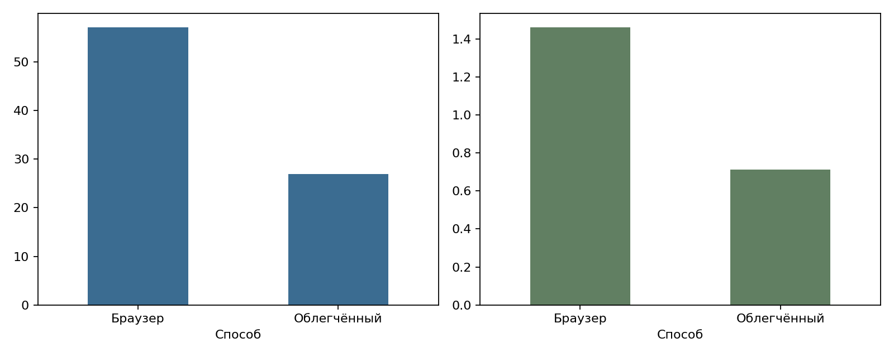
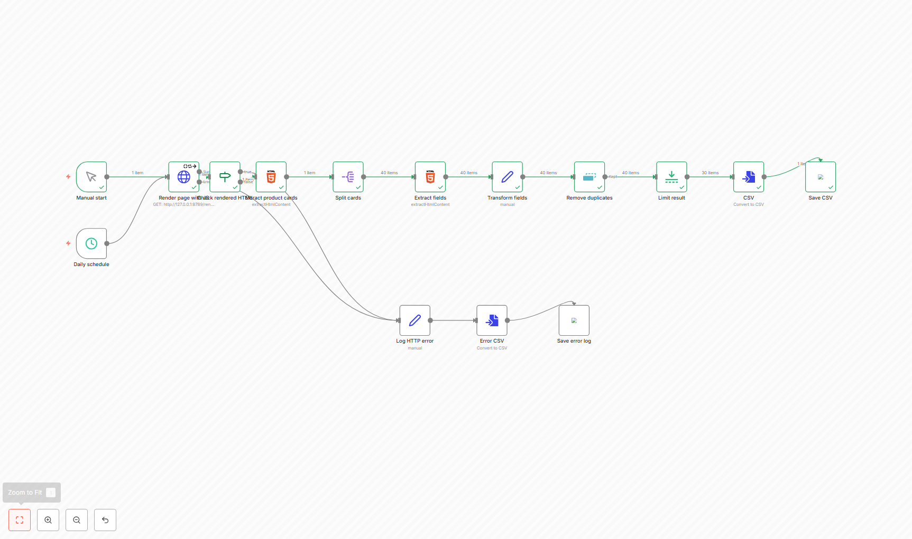
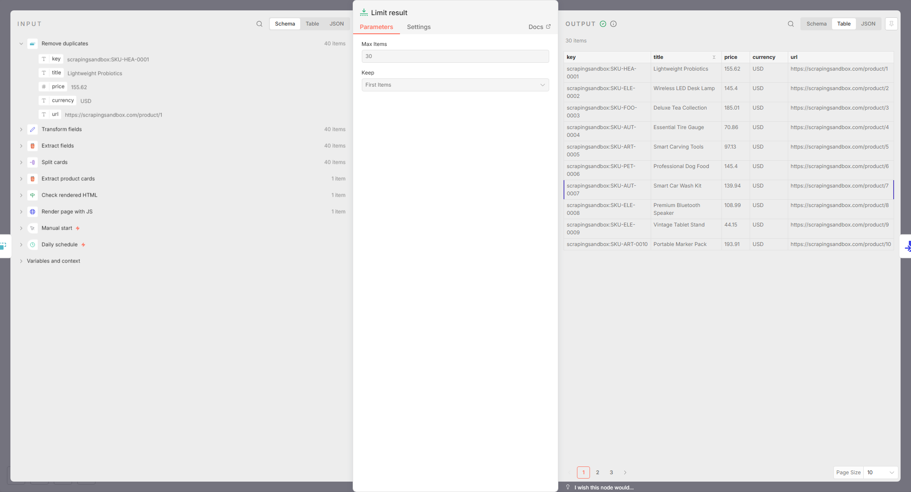

# Лабораторная 4. Динамические страницы

Вариант 3. На ScrapingCourse найдено 147 уникальных товаров.
Для набора от 200 записей добавлен ScrapingSandbox.
Итог - 347 товаров: 147 и 200 соответственно.
Задание требует не менее 200 записей и сравнение браузерного сбора с вариантом, который делает меньше загрузок.
Оба исходных набора и измерения сохранены. В блокноте по умолчанию показан этот прогон.

## Диагностика страниц

| Источник | Размер HTML, байт | Карточек в HTML | Карточек без JS до и после прокрутки |
|---|---:|---:|---|
| scrapingcourse | 18998 | 12 | 12 → 12 |
| scrapingsandbox | 122371 | 20 | 20 → 20 |

Исходный HTML содержит только первую порцию товаров.
При отключённом JavaScript прокрутка не добавляет карточки.
Контрольная статическая страница /ecommerce вернула HTTP 200 и 16 li.product уже в HTML. Корень разрешён robots.txt; запрещённые дочерние карточки не открывались. Ответ и проверка — control_static.html/json в artifacts.

HTML и скриншоты сохранены в [artifacts](artifacts). Название первого товара найдено в DOM внутри .product-name у обоих источников. Проверены 8 и 26 script-тегов; блоков application/json, JSON-LD и __NEXT_DATA__ в этих файлах нет. Подробности — artifacts/diagnostic_details.json.

ScrapingCourse загружает HTML через `GET /ajax/products?offset=0,10,20…`.
В конце сервер отвечает HTTP 204. Некоторые порции пересекаются, поэтому товары
проверяются по уникальному ключу.

ScrapingSandbox добавляет карточки из клиентского JavaScript.
Отдельный XHR с товарами и полный набор данных в исходном HTML не найдены.

## Playwright

[collect.py](collect.py) открывает браузер, прокручивает страницу, извлекает поля
и сохраняет CSV. Browser, context и page закрываются после сбора и при ошибке. Заданы учебный User-Agent, viewport 1280 × 900, locale en-US, timeout элементов 20 с и навигации 45 с. Получены 15 и 9 циклов прокрутки; минимум пяти выполнен.

| Локатор | Устойчивость | Возможная замена |
|---|---|---|
| .product-item / a.product-card | Смена класса сломает поиск; внутренняя div-обёртка и язык кнопки не мешают | data-product-id, если такой атрибут появится |
| .product-name | Смена класса сломает поле; вложенная обёртка и перевод кнопки не мешают | Заголовок или роль ссылки внутри карточки |
| .product-price / .price | Смена класса сломает цену; вложенная обёртка и язык кнопки не мешают | Стабильный data-price / itemprop при появлении |

В проверенных карточках нет устойчивых data-атрибутов для всех нужных полей, а цена не имеет доступной роли и подписи. Поэтому выбраны семантические классы. Позиционные XPath и служебные классы оформления не используются. Строки выше — предложения для будущего редизайна, а не существующие атрибуты.

Сценарий проходит три этапа: прокрутка, ожидание новых карточек, извлечение полей.
После прокрутки скрипт ждёт увеличения числа карточек через wait_for_function.
Ограничения: 35 итераций, три прокрутки без новых товаров и 200 записей на источник.
Пауза 250 мс ограничивает частоту прокрутки; она не заменяет ожидание карточек.

Поля извлекаются одним вызовом `eval_on_selector_all`.
Замер на одинаковых 50 товарах: поэлементный образец читал название и цену, массовый — все поля карточки. Поэтому это оценка затрат на обращения к браузеру, а не строго равной обработки:

| Источник | Поэлементно, с | Массово, с | Отношение времени |
|---|---:|---:|---:|
| scrapingcourse | 0.2369 | 0.0060 | 39.21 |
| scrapingsandbox | 0.3865 | 0.0082 | 47.18 |

При тайм-ауте сохраняются HTML, скриншот и текст ошибки.
Пример — [artifacts/timeout_test](artifacts/timeout_test).
Скрипт завершает работу с ненулевым кодом.

## Сбор с меньшим числом загрузок

Для ScrapingCourse используются requests к найденному XHR, паузы и повторы HTTP 429/5xx.
Для ScrapingSandbox остаётся Playwright, но блокируются изображения, шрифты и медиа.

[data_browser.csv](data_browser.csv) и [data_light.csv](data_light.csv) совпадают
по ключу, названию, цене и URL: 347 записей, 0 расхождений.
Цена сохранена как float. Дублей и пустых обязательных полей нет. Smoke-check quality проверяет долю строк без key/title/price/url с порогом 5%: на 347 строках она равна 0%, smoke_ok=true. Пустой набор и учебная запись с пропущенным полем дают предупреждение, а не исключение; результаты — artifacts/smoke_check.json.

## n8n

Локальный [render_api.py](render_api.py) открывает страницу и возвращает HTML после прокрутки.
n8n извлекает карточки и поля, удаляет дубли, оставляет 30 товаров и сохраняет CSV.
HTTP-ошибки и неверный HTML записываются в отдельный файл.

[Результат](nocode/nocode_result.csv) совпадает с таблицей Playwright по названию, цене и ссылке.
Сценарий сохранён в [workflow.json](nocode/workflow.json).

## Сравнение

| Показатель | Браузер | Облегчённый | n8n |
|---|---:|---:|---:|
| Подготовка до первой выгрузки, мин | 35.75 | В том же collect.py | 2.25 |
| Записей | 347 | 347 | 30 |
| Время, с | 57.09 | 26.90 | 5.90 |
| Сетевых ответов | 246 | 39 | 1 вызов рендерера + 22 внутри него |
| Тел ответов, МиБ | 1.461 | 0.713 | 0.210 от рендерера |
| Пик RSS, МиБ | 622.9 | 585.7 | 312.8 n8n + 491.6 рендерер |
| Секунд на запись | 0.1645 | 0.0775 | 0.1965 |
| Устойчивость к редизайну, субъективно 1–5 | 3 | 4 для XHR, 3 для DOM | 3 |
| Повторный запуск | Код и notebook | Код | Импорт JSON |

Время подготовки измерено до первой выгрузки, без установки окружения.
RSS включает дочерние процессы. Объём ответов указан без HTTP-заголовков.

На ScrapingCourse запросы к XHR сократили время и трафик.
На ScrapingSandbox блокировка медиа уменьшила число загрузок,
но в этом запуске ускорения и экономии измеренных тел ответов не дала:

| ScrapingSandbox | Обычно | Без медиа |
|---|---:|---:|
| Сетевых ответов | 215 | 22 |
| Заблокировано медиа | 0 | 201 |
| Время, с | 13.024 | 13.106 |
| Тел ответов, байт | 468866 | 579686 |
| Пик RSS, МиБ | 622.875 | 585.699 |

Время выросло на 0,63%, измеренное тело — на 23,64%; положительный результат здесь только по числу загрузок и памяти. Выдача ресурсов и момент замера меняются между запусками; причинное снижение трафика этим опытом не доказано. Для ScrapingSandbox применён domcontentloaded вместо load. Затем выполнена отдельная проверка трёх режимов на одинаковых 200 товарах. В каждом используется один контекст; итоговые скриншоты и замер извлечения отключены:

| Режим Sandbox | Время, с | Ответов | Тел, байт |
|---|---|---|---|
| load, медиа включены | 18.664 | 209 | 906070 |
| domcontentloaded, без медиа | 14.981 | 22 | 309207 |
| commit, без медиа | 14.502 | 22 | 232890 |

В этой проверке commit быстрее базы на 22,30% и передаёт на 74,30% меньше измеренных тел. Ключи, названия, цены и URL всех 200 строк совпали. Это лучший из трёх измеренных режимов, а не доказательство глобального предела производительности; browser_optimization.json содержит условия и замеры. В облегчённом режиме теперь используется commit, затем явное ожидание карточек.

n8n делает один вызов рендерера на 30 товаров.
Для 10 000 записей при таком размере порции потребовалось бы около 334 вызовов.
Это расчёт нагрузки; на учебных страницах такого количества товаров нет. При цене p за рендеринг вызовы стоят 334 × p за один сбор; локально плата сервису равна нулю.
Платный сервис рендеринга не использовался.

Для разового сбора подходит Playwright. Для регулярного сбора сначала нужен доступный API или XHR:
он требует меньше ресурсов. Браузер нужен, когда данные добавляет JavaScript.
Для источника с антибот-защитой выбирается официальный API, открытый набор или разрешение владельца; обход защиты не применяется.

## Условия использования

Оба сайта предназначены для обучения.
У ScrapingCourse запрещён путь `/ecommerce/*`: эти ресурсы блокируются,
страницы товаров по таким ссылкам не открываются.
Набор содержит товары, без персональных данных, поэтому основание обработки по
[152-ФЗ](https://mintrud.gov.ru/docs/laws/130) для него не требуется.
Диагностические HTML и скриншоты предлагается хранить 30 дней после проверки.

Источники: [ScrapingCourse](https://www.scrapingcourse.com/infinite-scrolling), [ScrapingSandbox](https://scrapingsandbox.com/infinite-scroll), [Playwright network](https://playwright.dev/python/docs/network), [HTML n8n](https://docs.n8n.io/integrations/builtin/core-nodes/n8n-nodes-base.html/).
