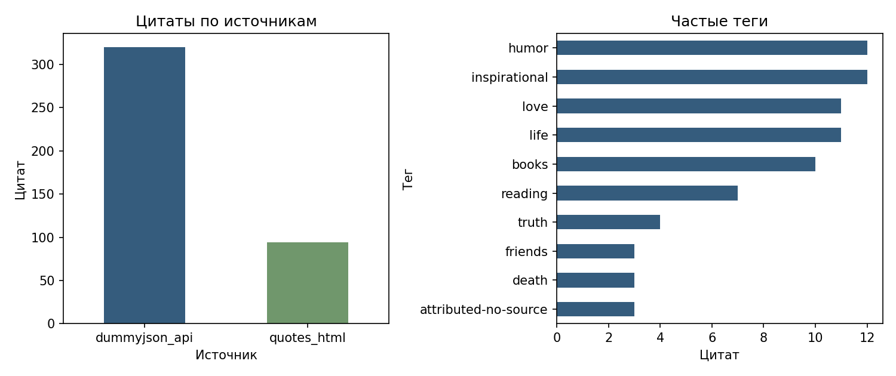
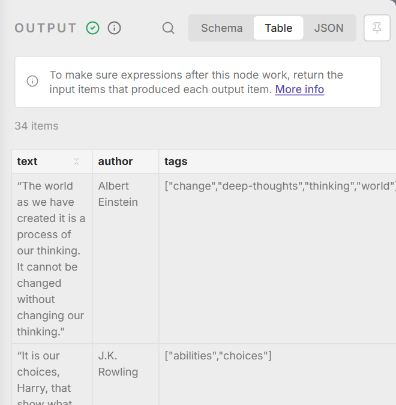

# Лабораторная 6. Хранение, очистка и структура данных

## 1. Цель и вариант

Вариант 3: цитаты и авторы. Собрано общее хранилище для HTML и API: сырые записи сохраняются отдельно, чистые проверяются контрактом, аналитические представления строятся только при допустимом качестве.

## 2. Источники и слои

HTML-набор из пятой работы содержит 100 цитат и теги; год рождения получен из ранее посещённых страниц авторов. В исходном HTML сохранены значения до очистки и разметка карточки. Для объёма от 300 записей добавлен учебный DummyJSON: четыре порции по 80 цитат. API содержит текст и имя автора, но не теги и дату рождения. Это новый дополнительный источник: API третьей работы был Open Library; DummyJSON расширяет исходный корпус до нужного объёма. Недостающие сведения не выдумываются.

Добавлены 32 явно помеченные учебные записи с пробелами, дублями, пропусками и ошибками: 7,08% от 452 входных строк. Эти случаи не выдаются за новые цитаты источника.

Схема: raw (JSONL и происхождение) → clean (контракт, Parquet, rejects) → SQLite и mart (агрегаты и партиции). В каждой сырой строке есть _source, _source_url, _collected_at в UTC, _parser_version и _status. Manifest хранит размер и SHA-256 прежних байтов; разрешена дозапись, изменение старых строк отклоняется. Команда python -m src.rebuild работает без обращения к сайтам. Повторная проверка подтвердила сохранность raw.

## 3. Сравнение форматов

Тот же набор из 414 строк записан в три формата. Время — медиана семи последовательных чтений на этом ПК; это замер небольшого набора с прогретым файловым кэшем.

| Формат | Размер, байт | Всё, мс | 3 столбца, мс |
|---|---|---|---|
| CSV | 137434 | 8.35 | 6.23 |
| JSONL | 209284 | 20.97 | 21.09 |
| Parquet | 72574 | 6.15 | 4.21 |

CSV возвращает дату как object, JSONL и Parquet — datetime с UTC. При автоматическом чтении Pandas строковый ID 000100 превращается в 100 в CSV и JSONL. В самом JSONL строка сохранена: потеря нулей происходит из-за вывода типа читателем. Для них нужен явный dtype. Parquet сохраняет string и 000100.

Для raw выбран JSONL: построчная дозапись и сохранение происхождения. Для clean и mart — Parquet: типы, списки тегов и выбор столбцов. CSV оставлен для просмотра и обмена.

<!-- PAGEBREAK -->

## 4. Протокол очистки

| Этап | До | После | Изм. | Удал. | Примечание |
|---|---|---|---|---|---|
| 1. Нормализация текста | 452 | 452 | 17 | 0 | NFKC, NBSP, zero-width, пробелы |
| 2. Бизнес-ключ и URL | 452 | 452 | 452 | 0 | SHA-ключ у всех строк; tracking-URL: 8 |
| 3. Типизация | 452 | 446 | 446 | 6 | UTC, числовой год, строковый ID; ошибки в rejects |
| 4. Пропуски | 446 | 434 | 0 | 12 | Текст, автор и URL обязательны; неизвестный год = NULL |
| 5. Полные, ключевые и почти-дубли | 434 | 420 | 0 | 14 | Сохранена самая свежая запись |
| 6. Бизнес-правила и контракт | 420 | 414 | 0 | 6 | Полный pydantic-контракт; поле и причина в rejects |

Текст проходит NFKC, удаление неразрывных и zero-width пробелов и схлопывание пробелов. Ключ — SHA-256 нормализованной пары автор + цитата; из URL удаляются параметры трекинга. Даты приводятся к UTC, целые с пропусками — к Int64. Денежных полей в этом варианте нет. Обязательные пропуски отбраковываются, необязательный год рождения остаётся NULL. Средние значения вместо пропусков не используются.

Полные, ключевые и почти-дубли сравниваются по тексту и автору без различий регистра и пунктуации; сохраняется свежая запись. В сумме удалены 14 дублей и отбракованы 24 строки: шесть с неверной датой, 12 с обязательными пропусками и шесть с неверными тегами. После очистки осталось 414 уникальных цитат.

## 5. Контракт данных

Модель Quote находится в src/contract.py. Проверяются длина текста и имени, формат ключей, число и форма тегов, UTC и отсутствие будущей отметки сбора. field_validator проверяет текст, теги и дату; model_validator связывает ключ с текстом и автором, проверяет длину и соответствие URL источнику. Правила: 1) текст 8–2000 символов без HTML; 2) имя 2–150 символов; 3) до 20 тегов-slug; 4) UTC и допустимое время сбора; 5) SHA-ключ соответствует автору и цитате; 6) ключ автора соответствует имени; 7) длина равна тексту и URL принадлежит указанному источнику. Ошибки сохраняются с полем, причиной и исходным payload в rejects.jsonl.

| Проверка | Результат | Сообщение |
|---|---|---|
| Пустой текст | отклонено | String should have at least 8 characters |
| Короткое имя | отклонено | String should have at least 2 characters |
| Неверный тег | отклонено | Value error, Тег должен быть непустым slug в нижнем регистре |
| Дата без зоны | отклонено | Value error, Нужен часовой пояс UTC |
| Неверный ключ | отклонено | Value error, Бизнес-ключ не соответствует тексту и автору |
| Неверная длина | отклонено | Input should be greater than 7 |
| Неверный источник URL | отклонено | Value error, URL не соответствует источнику |

Все 414 итоговых записей дополнительно проверены той же моделью.

<!-- PAGEBREAK -->

## 6. SQLite, ключи и история

В schema.sql описаны authors, quotes, quote_tags, rejects и quote_history. Ключ цитаты — первичный; author_key связан внешним ключом с авторами. Пара источник + исходный ID уникальна. NOT NULL и CHECK защищают обязательные поля, длины и диапазоны. Связи: authors 1 → N quotes; quotes 1 → N quote_tags и quote_history. rejects хранит отдельный брак с исходным payload. Индексы idx_quotes_author, idx_quotes_source и idx_tags_tag используются в соответствующих агрегатах.

Пакетный UPSERT сравнивает хэш значений. Если содержимое не изменилось, строка и updated_at не обновляются. UTC канонизируется до вычисления хэша, поэтому Z и +00:00 не создают ложных изменений. История хранит полный снимок только при первом появлении или изменении записи. Для небольшого набора с редкими изменениями снимок позволяет восстановить значения по ключу и времени без сложных интервальных запросов.

Отдельная idempotency_demo.db содержит три прогона. В третьем учебно изменены теги двух записей; основная warehouse.db содержит исходный чистый набор.

| Загрузка | Строк | Вставлено | Обновлено | История |
|---|---|---|---|---|
| A | 414 | 414 | 0 | 414 |
| B | 414 | 0 | 0 | 414 |
| C | 414 | 0 | 2 | 416 |

В повторе updated_at сохранился у всех 414 строк. Попытки нарушить CHECK, вставить дублирующийся ключ и записать NULL в обязательное поле завершились отказом SQLite.

## 7. Качество и светофор

| Метрика | Значение | Зелёный | Жёлтый | Статус |
|---|---|---|---|---|
| Обязательные поля | 100.00% | ≥100.00% | ≥99.00% | green |
| Год рождения автора | 22.71% | ≥10.00% | ≥5.00% | green |
| Уникальность ключа | 100.00% | ≥100.00% | ≥99.00% | green |
| Валидность сырых записей | 94.69% | ≥90.00% | ≥80.00% | green |
| Доля отбраковки | 5.31% | ≤10.00% | ≤20.00% | green |
| Бизнес-правила | 100.00% | ≥100.00% | ≥99.00% | green |
| Медианный возраст, дней | 0.26 | ≤30.00 | ≤60.00 | green |
| Изменение объёма | 0.00% | ≤10.00% | ≤20.00% | green |

Каждая из 452 сырых строк отдельно проходит очистку и полный контракт; прошли 428: 428 / 452 = 94,69%. Дедупликация затем уменьшает чистый слой до 414. Метрика бизнес-правил повторно проверяет весь контракт, а не только длину. Красный — значение ниже жёлтого минимума либо выше жёлтого максимума. Порог отбраковки учитывает намеренно внесённые дефекты до 10%. Год рождения необязателен и доступен только у части авторов; его порог не равен порогу обязательных полей. Возраст оценивается по медиане, поскольку это учебные метаданные, а не оперативные наблюдения.

Итог — green. Функция require_mart останавливает загрузку при красной метрике. Демонстрация --force-red вернула код 2; хэши raw и mart до и после совпали.

<!-- PAGEBREAK -->

## 8. Аналитический слой

Получены 414 цитат, 98 авторов и 205 связей с тегами. Созданы три SQL-представления и их Parquet-выгрузки: цитаты по авторам, по источникам и частые теги. В чистом наборе 94 строки HTML и 320 API.

Снапшоты разделены по дате сбора в mart/snapshots/dt=… . Проверка читает одну выбранную партицию через фильтр Parquet; результат записан в partition_read.json. При пересборке затронутые партиции заменяются, имена файлов стабильны: повтор не дописывает те же цитаты. Две пересборки дали по 414 строк и 414 уникальных ключей, файлы партиций совпали; snapshot_validation.json.

## 9. Код и n8n

n8n читает 39 подготовленных строк из обоих источников. Normalize fields очищает текст и имя, приводит дату и строковый ID; Crypto считает SHA-ключ. IF отделяет три невалидные строки, Remove duplicates удаляет два повтора. На выходе — 34 строки, их ключи, тексты и авторы совпали с Python. CSV создаётся самим n8n; отдельного скрипта очистки после экспорта нет.

| Этап | Python | n8n | Ограничение n8n-сценария |
|---|---|---|---|
| Raw | JSONL, контроль прежних байтов | Чтение подмножества | Нет контроля append-only |
| Нормализация | NFKC, URL, UTC, nullable | Code и Crypto, 3+ поля | Не все типы и URL-правила |
| Контракт | Полная модель pydantic | IF, основные проверки | Нет полной модели согласованности |
| Дубли и брак | Ключ, почти-дубли, rejects | Remove duplicates, IF, CSV | Нет поиска почти-дублей |
| БД и история | SQLite UPSERT и снимки | CSV | Нет UPSERT и истории в CSV |
| Mart и качество | 8 метрик, пороги, партиции | Не реализовано | Нет светофора и mart |
| Расписание | Внешний запуск | Daily schedule | Ручной прогон проверен |

Для UPSERT из n8n нужна ветка загрузки в Postgres/MySQL либо отдельный интерфейс БД. В выбранном CSV-экспорте такой операции нет. Это ограничение данного сценария, а не всей платформы.

<!-- PAGEBREAK -->

## 10. Результат n8n

Время успешного исполнения — 0.865 с по startedAt/stoppedAt n8n, без импорта workflow и опроса API. Успешный результат и отвергнутые строки сохранены отдельно. [Схема workflow](nocode/workflow.png), [экспорт JSON](nocode/workflow.json), [таблица CSV](nocode/nocode_result.csv).

## 11. Правовая оценка и вывод

Цель — учебная проверка хранения и качества данных. Источники предназначены для обучения и тестирования. Сохраняются тексты цитат, имена, теги и доступный год рождения; адреса, контакты и полные биографии в это хранилище не перенесены. Имена и год рождения рассматриваются как потенциальные персональные данные, а авторство цитат отдельно не проверялось.

Для учебной научной деятельности рассмотрен п. 8 ч. 1 ст. 6 152-ФЗ с соблюдением прав человека. Открытая страница сама по себе не разрешает любое распространение текста или персональных сведений. Для GDPR отдельно учитываются территориальная применимость, принципы минимизации и ограничения хранения из статьи 5 и необходимость основания из статьи 6.

Файлы хранятся локально и в учебном репозитории. Предлагаемый срок — до 30 дней после проверки; удаление должно учитывать raw, кэши, БД, резервные и версионные копии. Для дальнейшей публикации достаточно агрегатов.

Выбран Python с SQLite и Parquet: он сохраняет контракт, происхождение и историю. n8n подходит для расписания и небольшого экспорта, но в этой реализации не заменяет слой качества.

## Источники

- [DummyJSON Quotes](https://dummyjson.com/docs/quotes), [Quotes to Scrape](https://quotes.toscrape.com/).
- [Pydantic: validators](https://docs.pydantic.dev/latest/concepts/validators/).
- [SQLite UPSERT](https://www.sqlite.org/lang_upsert.html), [Apache Arrow Parquet](https://arrow.apache.org/docs/python/parquet.html).
- [n8n Remove Duplicates](https://docs.n8n.io/integrations/builtin/core-nodes/n8n-nodes-base.removeduplicates/).
- [152-ФЗ](https://mintrud.gov.ru/docs/laws/130), [GDPR](https://eur-lex.europa.eu/eli/reg/2016/679/oj/eng).
