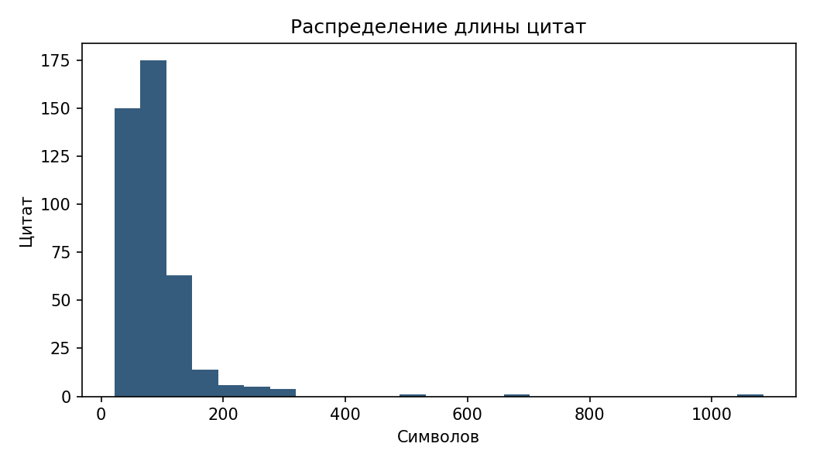
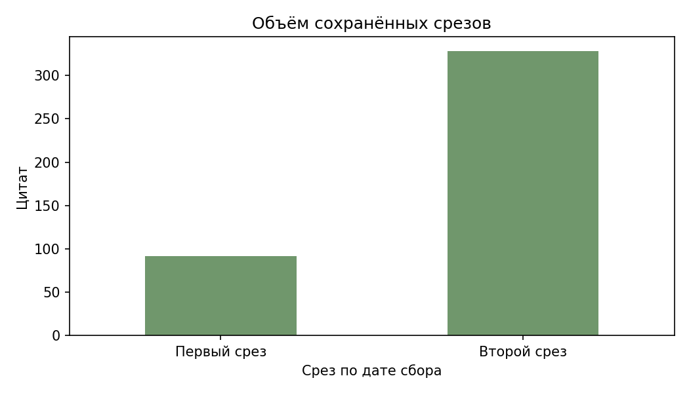

# Лабораторная работа № 6

Хранение, очистка и структурирование собранных данных

**ПМИ-2-2025. Вариант 3.**

## 1. Цель и вариант

Построить воспроизводимое хранилище цитат и авторов: raw → clean → mart, с контрактом данных, историей в SQLite и контролем качества. В таблице вариантов указан номер 26: (26 mod 6) + 1 = 3. Чистый слой содержит 420 цитат, что превышает минимум 300.

## 2. Источники и их различия

Использованы сохранённые снимки из локального архива предыдущих работ, новый сбор для выполнения этой работы не потребовался.

| Источник | Состав и происхождение | Отличия |
| --- | --- | --- |
| HTML Quotes to Scrape | 100 цитат, страницы 1–10, снимок лаб. 5 | Текст, автор, теги, исходная html_raw карточка, год рождения из сохранённых сведений автора |
| API DummyJSON Quotes | 320 цитат, 4 страницы по 80, api_raw | JSON: id, quote, author, теги отсутствуют, год рождения NULL |

DummyJSON — дополнительный сохранённый учебный API, а API лабораторной № 3 был Open Library. Все 320 объектов api_raw совпали с текущими значениями DummyJSON при контрольной сверке. Даты в raw относятся к архивному сбору, а не к этой сверке. Имена и авторство передаются как сведения источника, без проверки атрибуции. Добавлены 32 явно помеченных дефектных копии (_synthetic, _injected_reason): 7,08% от 452 входных строк, они не создают новые цитаты.

## 3. Схема трёхслойного хранилища

raw/*.jsonl → шесть шагов очистки + pydantic → clean/*.parquet и rejects → SQLite UPSERT → проверка светофора → mart/views и snapshots/dt=дата. Сырые строки содержат _source, _source_url, _collected_at (UTC ISO 8601), _parser_version, _status. Для HTML сохранены все целевые *_raw и карточка. manifest.json проверяет SHA-256 прежнего префикса: дозапись допустима, изменение прежних байтов останавливает пересборку. Это программная проверка, а не файловая защита от владельца диска.

Команда `python -m src.rebuild` читает только локальный raw, повтор сохранил 420 строк, хэши raw и число строк партиций. Полные результаты и исполняемые проверки находятся в quality_report.ipynb.

## 4. Сравнение форматов

Один набор из 420 строк, без искусственного размножения. Время — медиана 7 чтений с прогретым файловым кэшем, столбцы: source_record_id, collected_at, text_length.

| Формат | Байт | Всё, мс | 3 столбца, мс | Дата, ID после чтения |
| --- | --- | --- | --- | --- |
| CSV | 140071 | 2.81 | 2.03 | object, int64, 100 |
| JSONL | 215575 | 5.92 | 6.10 | UTC datetime, int64, 100 |
| Parquet | 74376 | 2.66 | 1.84 | UTC datetime, string, 000100 |

Автовывод типов pandas теряет нули 000100 в CSV и JSONL, JSONL сам хранит строку корректно. Явные dtype, UTC и декодирование списка восстанавливают одинаковые значения всех строк (format_roundtrip.json). Raw выбран JSONL для дозаписи и исходных полей, clean и mart — Parquet для типов, списков и чтения выбранных столбцов. CSV служит обмену. Замер на малом наборе не доказывает универсального превосходства по скорости.

<!-- PAGEBREAK -->

## 5. Протокол очистки

| Шаг | До | После | Изменено | Удалено |
| --- | --- | --- | --- | --- |
| 1. Нормализация текста | 452 | 452 | 17 | 0 |
| 2. Бизнес-ключ и URL | 452 | 452 | 452 | 0 |
| 3. Типизация | 452 | 446 | 446 | 6 |
| 4. Пропуски | 446 | 434 | 0 | 12 |
| 5. Полные, ключевые и почти-дубли | 434 | 420 | 0 | 14 |
| 6. Бизнес-правила и контракт | 420 | 420 | 420 | 0 |

Текст: NFKC, удаление NBSP и zero-width, схлопывание пробелов. Ключ цитаты — SHA-256 строки source + '|' + source_record_id, ключ автора — хэш имени. Пространство имён источника исключает совпадение его ID с другим сервисом. Исправления текста, тегов и даты сохраняют ключ цитаты, автоматическое объединение разных написаний имён не выполняется. Источниковый ID остаётся строкой с ведущими нулями. Даты timezone-aware UTC, год рождения nullable Int64, денежных полей в варианте нет. Обязательные пропуски отбраковываются, необязательные остаются NULL, среднее не подставляется.

На шаге 5 образованы 420 групп, 14 альтернатив сохранены для проверки. На шаге 6 контракт проверяет всех кандидатов и выбирает самый свежий валидный. В 6 группах дефектная свежая копия отклонена, сохранена корректная старая. Поэтому 14 альтернатив в журнале дублей включают 8 валидных дублей и 6 отклонённых записей. Непересекающийся баланс: **452 = 420 принятых + 24 отклонённых + 8 дублей** (raw_disposition.json). Причины брака: 6 неверных дат, 12 обязательных пропусков, 6 неверных тегов. Все удаления имеют исходный payload и причину, изменено означает преобразованные записи, включая построение типизированной записи на шаге 6.

## 6. Контракт данных и демонстрация ошибок

Модель Quote в src/contract.py задаёт обязательность, типы, min_length, gt/le и диапазон года. Три field_validator проверяют очищенный текст, slug-теги и дату UTC, model_validator связывает бизнес-ключ с ID источника, ключ автора с именем, длину текста и домен URL. Доменные правила: текст 8–2000 символов, имя 2–150, не более 20 тегов-slug, допустимый год рождения, дата UTC не из будущего, соответствие ключей содержимому, длина равна тексту, URL соответствует источнику. Каждый из 420 итоговых объектов прошёл тот же контракт.

| Проверка | Результат | Сообщение об ошибке |
| --- | --- | --- |
| Пустой текст | отклонено | String should have at least 8 characters |
| Короткое имя | отклонено | String should have at least 2 characters |
| Неверный тег | отклонено | Тег должен быть непустым slug в нижнем регистре |
| Дата без зоны | отклонено | Нужен часовой пояс UTC |
| Неверный ключ | отклонено | Бизнес-ключ не соответствует источнику и ID |
| Неверная длина | отклонено | Input should be greater than 7 |
| Неверный источник URL | отклонено | URL не соответствует источнику |

В rejects.jsonl и таблице rejects сохраняются raw_index, этап, поле, причина, признак учебного дефекта и payload. Неизвестные теги API представлены пустым списком, а не придуманными значениями.

<!-- PAGEBREAK -->

## 7. База данных и история изменений

schema.sql описывает authors (ключ автора), quotes (бизнес-ключ), quote_tags (составной ключ цитата + тег), rejects и quote_history. Связи authors 1:N quotes, quotes 1:N quote_tags/history. Обязательные поля защищены NOT NULL, длины и диапазоны — CHECK, UNIQUE(source, source_record_id) запрещает повтор идентификатора источника. Внешние ключи включены. Индексы author_key, source и tag соответствуют запросам трёх представлений.

Пакетный executemany выполняет ON CONFLICT DO UPDATE с условием изменения хэша. При одинаковом содержимом updated_at сохраняется. quote_history записывает полный снимок при первой загрузке и при изменении, для малого набора это проще интервальной SCD2. Неизменный бизнес-ключ сохраняет историю правок текста и метаданных. Загрузка принимает полный clean-снимок, отсутствующие ключи остаются в БД с is_active=0, а вернувшиеся активируются. Все три представления учитывают только is_active=1, это сохраняет соответствие mart чистому снимку при смене победителя среди почти-дублей.

Три прогона выполнены в отдельной демонстрационной БД, основная warehouse.db содержит исходный чистый набор. В C учебно изменены теги двух цитат.

| Прогон | Строк | Вставлено | Обновлено | Без изменений | История |
| --- | --- | --- | --- | --- | --- |
| A | 420 | 420 | 0 | 0 | 420 |
| B | 420 | 0 | 0 | 420 | 420 |
| C | 420 | 0 | 2 | 418 | 422 |

В B все 420 updated_at сохранились, в C изменились ровно два ключа, история выросла на две строки. INSERT с text_length=0 отклонён CHECK, дублирующий business_key — PRIMARY KEY, NULL текста также отклонён. Подробные сообщения SQLite сохранены в idempotency.json. Проверки не меняют warehouse.db.

## 8. Метрики качества и светофор

| Метрика | Значение | Зелёный | Жёлтый | Статус |
| --- | --- | --- | --- | --- |
| Обязательные поля | 100.00% | ≥100% | ≥99% | зелёный |
| Год рождения | 23.81% | ≥10% | ≥5% | зелёный |
| Уникальность ключей | 100.00% | ≥100% | ≥99% | зелёный |
| Валидность raw | 94.69% | ≥90% | ≥80% | зелёный |
| Доля отбраковки | 5.31% | ≤10% | ≤20% | зелёный |
| Бизнес-правила | 100.00% | ≥100% | ≥99% | зелёный |
| Медианный возраст, дней | 12.84 | ≤30 | ≤60 | зелёный |
| Изменение объёма | 0.00% | ≤10% | ≤20% | зелёный |

Красный — выход за жёлтый предел. Обязательные поля и ключи требуются полностью, год рождения есть лишь у HTML, поэтому его отдельный минимальный порог 10%. Валидность 428/452 проверяет каждую сырую строку после нормализации до дедупликации, принятый набор меньше из-за дублей. Пределы брака 10/20% учитывают 7,08% учебных дефектов. Возраст 30/60 дней выбран для учебного справочного набора. Допуск объёма 10/20% обнаруживает пропуски страниц. На первом запуске сравнение объёма отмечено как bootstrap, на повторе предыдущий объём равен 420.

Итоговый вердикт — **зелёный**. require_mart прекращает построение при красном показателе с его названием. Контроль `--force-red` завершился кодом 2, хэши всех файлов mart сохранились (red_gate_evidence.json). Возраст меняется при новом запуске, старый снимок закономерно может перестать проходить порог.

<!-- PAGEBREAK -->

## 9. Аналитический слой mart

Получены 420 цитат: 100 HTML и 320 API, 101 авторов, 232 связей с тегами. SQL-представления quotes_by_author (число цитат и средняя длина), quotes_by_source (объём и средняя длина), popular_tags (частота тегов) экспортируются в mart/views/*.parquet.

Снимки разделены по дате сбора на две партиции вида dt=YYYY-MM-DD. Чтение только первой партиции через фильтр вернуло 92 строки. Повтор заменяет затронутые файлы партиций, а не дописывает копии. Суммарное число строк и уникальных ключей остаётся 420. Более поздняя дата у части HTML — помеченные учебные копии уже известных цитат, это не новый сбор HTML.

Рисунок 1. Длина текста в символах по чистому набору.

Рисунок 2. Распределение записей по двум сохранённым срезам. Показаны архивные наблюдения и учебные копии, а не изменение популярности или содержания цитат во времени.

<!-- PAGEBREAK -->

## 10. Сопоставление Python и n8n

n8n обработал 39 входных строк из обоих источников: 34 валидные, 3 отклонённые и 2 дубля. Нормализуются текст, автор, дата и исходный ID, Crypto считает SHA-ключ, IF разделяет потоки, Remove Duplicates удаляет повторы. CSV и отдельный rejects.csv создаёт сам workflow, Python их сверяет с clean. Сохранены workflow.json, реальные screenshot_workflow.png и screenshot_result.png.

| Этап | Python | n8n | Ограничение сценария |
| --- | --- | --- | --- |
| Raw | JSONL + SHA префикса | Чтение сохранённого поднабора | Нет контроля append-only |
| Нормализация | NFKC, URL, UTC, nullable | Code + Crypto, 4 поля | Нет полного набора типов/правил URL |
| Контракт и брак | pydantic + rejects + БД | IF → отдельный CSV | Нет полной межполевой модели |
| Дубли | Ключ и почти-дубли | Remove Duplicates | Нет почти-дублей и fallback |
| Загрузка и история | SQLite UPSERT + снимки | CSV с заменой файла | Нет UPSERT и истории в CSV |
| Качество и mart | 8 метрик, gate, партиции | Не реализовано | Нет светофора и mart |
| Расписание | Запуск команды | Daily schedule 08:00 | Для автоматики нужна активация |

CSV не поддерживает обновление по ключу, поэтому выбранный экспорт не выполняет UPSERT. Для него требуется Postgres/MySQL Upsert с подключением к БД, это возможность n8n, которая в данном сценарии не настроена. Замена CSV при повторе не считается UPSERT. Ежедневное расписание задано в Asia/Yekaterinburg, workflow экспортирован неактивным. Ручной запуск проверен. Этот сценарий сокращает ручную работу экспорта, но полный слой качества реализован в Python.

## 11. Правовой раздел

Сохраняются короткие тексты цитат, имена, теги и доступный год рождения. Контакты, адреса, полные биографии и страницы авторов не копируются в сдачу. Имя и год рождения могут быть персональными данными, хэш имени не обеспечивает обезличивание. Публичная доступность сама по себе не является согласием на любое использование или распространение.

Цель — локальная учебная проверка. По 152-ФЗ отдельно оцениваются принципы минимизации (ст. 5), основание обработки (ст. 6) и распространение (ст. 10.1). Пункт 9 ч. 1 ст. 6 для исследования требует обезличивания и не служит автоматическим основанием хранения имён, согласие и иное применимое основание в этой работе не установлены. Применимость GDPR зависит от условий ст. 3, при применимости нужны основание ст. 6 и соблюдение минимизации/сроков ст. 5. Учебная цель не отменяет авторские права на тексты. Поэтому этот комплект предназначен для локальной сдачи, публикация исходных текстов и имён отдельно не обосновывается.

Хранение — локальная папка lab6_3, доступ владельцу и проверяющему. Предлагаемый срок — до 30 дней после проверки, удаление должно охватить raw, БД, CSV, архив и резервные копии. Для дальнейшего распространения достаточно агрегатов без имён и текстов.

## 12. Источники

1. [Quotes to Scrape](https://quotes.toscrape.com/) и [DummyJSON Quotes](https://dummyjson.com/docs/quotes).
2. [Демонстрационный блокнот занятия 6](https://colab.research.google.com/drive/1tRXXnj0phaWJvBosnY3G_PNIBCQA1ve9) — структура этапов, адаптирован к цитатам.
3. [Pydantic validators](https://docs.pydantic.dev/latest/concepts/validators/), [SQLite UPSERT](https://sqlite.org/lang_upsert.html), [PyArrow Parquet](https://arrow.apache.org/docs/python/parquet/), [n8n Remove Duplicates](https://docs.n8n.io/integrations/builtin/core-nodes/n8n-nodes-base.removeduplicates/).
4. [152-ФЗ, действующий текст](https://base.garant.ru/12148567/), [GDPR, официальный текст](https://eur-lex.europa.eu/eli/reg/2016/679/oj/eng).
