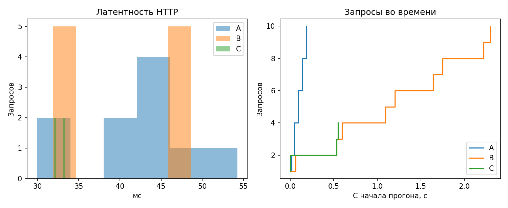
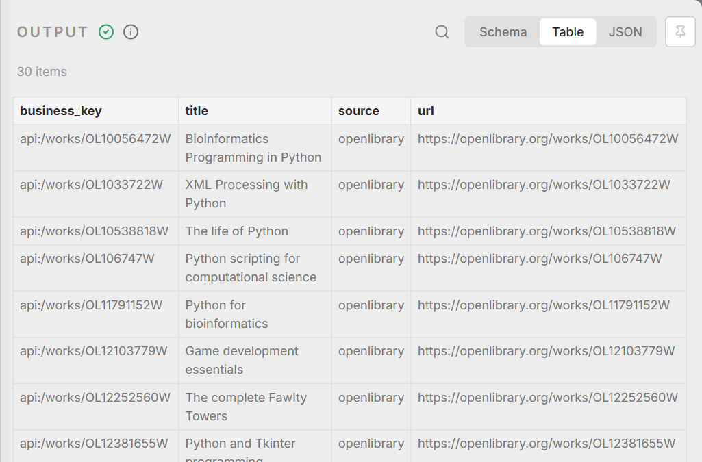

# Лабораторная 7. Устойчивый сбор данных

## 1. Цель и вариант

Вариант 3: смешанный сбор HTML + API. Обязательные случаи — 500 у одного источника при работающем втором и 404 на части URL. За основу взят HTTP-сборщик третьей работы; HTML-извлечение адаптировано из пятой.

A/B/C выполнены на локальном учебном HTTP-стенде: по 30 ранее сохранённых цитат и книг, всего 60 уникальных записей. HTML пересобран из сохранённых полей, JSON приведён к records. Это управляемые учебные ответы, а не имитация новых обращений к внешним сайтам.

## 2. Аудит исходного решения

| Механизм | Исходный код | Доработка |
|---|---|---|
| Session, User-Agent, timeout | Были в сборщике 3 | Сохранены |
| Скорость | Пауза между запросами | Token bucket по доменам и адаптация |
| Повторы | 429/5xx, задержка с добавкой | Full jitter, cap, бюджет URL, Retry-After |
| Изоляция отказа | Предохранителя не было | Closed / open / half-open |
| Экономия | Кэш авторов и известные ключи | HTTP 304, gzip, manifest и watermark |
| Диагностика | Статус и Content-Type | Маркеры, ожидаемые записи, история, пороги |

Модули limiter, retry, breaker, detector и observability отделены от collect. Логика и данные находятся внутри lab7; импортов из других лабораторных нет.

## 3. Скорость и robots.txt

На локальном стенде задано 2 запроса/с, burst 1 и положительный джиттер до 25% интервала. При медианной латентности около 41 мс интервал 0,5 с существенно больше времени ответа; параллельные запросы на один origin не нужны. Задержка пересчитывается по латентности, а при 429/503 увеличивается. Crawl-delay и request-rate имеют приоритет.

Два loopback-адреса представляют независимые учебные источники. Один координатор назначает домен одному воркеру. Межпроцессная файловая блокировка не даёт второму процессу одновременно забрать этот домен; это проверено отдельным процессом. Для четырёх процессов домены нужно распределить между владельцами, а не умножать локальный лимит на четыре. Redis и распределённая очередь в этой работе не используются.

На реальном Quotes robots.txt вернул 404: запрета нет, собственный лимит сохраняется. Получены 10 цитат из настоящего ответа. Open Library вернул robots.txt, но can_fetch для Search URL оказался false: запрос пропущен. Для внешней проверки задано 0,9 запроса/с, ниже базового лимита API в один запрос/с. Данные A/B/C взяты из прежнего сохранённого набора. Для нашего User-Agent Crawl-delay и request_rate не заданы. У Open Library правило User-agent: * / Disallow: /search охватывает /search.json, Sitemap — /static/sitemaps/siteindex.xml.gz; у Quotes robots.txt отсутствует. Исходные правила и повторная проверка сохранены в reports/robots_openlibrary.txt и robots_review.json.

Интервалы начала запросов восстановлены из ts − ms журнала B. Минимум: 0,533 с для HTML и 0,534 с для API; медианы 0,548 и 0,556 с. Обе серии выше базового интервала 0,5 с. Выбор даёт более чем десятикратный запас к медианной латентности около 41 мс; burst 1 исключает одновременный всплеск. Подробности — reports/rate_limits.json.

<!-- PAGEBREAK -->

## 4. Политика повторов

| Ответ или ошибка | Действие | Ограничение |
|---|---|---|
| 200 / 304 | Проверка содержимого или локальная копия | 304 без копии считается ошибкой |
| 429 | Задержка, повтор | Приоритет Retry-After; число или HTTP-дата |
| 500–599 | Повтор и учёт отказа домена | Full jitter: random(0, min(cap, base × 2^attempt)) |
| Сетевая ошибка | Ограниченный повтор | Не более трёх попыток и восьми секунд на URL |
| 401 / 403 | Без повтора | Фиксация авторизации или блокировки |
| Другие 4xx, включая 404 | Без повтора | URL записывается в журнал |

Для backoff base = 0,25 с, cap = 2 с. Retry-After не обрезается до cap: если ожидание не помещается в оставшийся бюджет URL, запрос прекращается. Каждая попытка и выбранная задержка с её источником записываются в JSONL.

## 5. Предохранитель и изоляция

После двух последовательных временных отказов домен переходит в open на 1,2 с. Во время паузы запросы не отправляются. Затем разрешается один half-open запрос: успех возвращает closed, новый отказ снова открывает предохранитель.

В сценарии два подготовленных HTTP 500 остановили HTML-источник, а API продолжил работу. В журнале есть circuit_open, skip_open, circuit_half_open и circuit_closed. После паузы HTML-ответ успешно обработан. Два URL с 404 были запрошены ровно по одному разу.

## 6. Детектор блокировки

Проверяются 403/429, маркеры captcha / access denied / «доступ ограничен», слишком малое тело и отсутствие ожидаемых записей при HTTP 200. 429 даёт подозрение и снижение частоты; явный маркер, 403 или подменённое содержимое — блокировку.

Подготовленная заглушка 200 с CAPTCHA остановила только HTML-домен. Тело и заголовки сохранены в logs/incidents, API продолжил работу. Процесс вернул код 2. Детектор также проверен на настоящем HTML-ответе с десятью цитатами; обхода заглушки не предпринималось.

<!-- PAGEBREAK -->

## 7. Снижение нагрузки

Ресурсы имеют ETag и Last-Modified. Валидаторы сохраняются в state/etags.json и отправляются как If-None-Match / If-Modified-Since. При 304 используется уже проверенная локальная копия. Слабый ETag и Vary учитывают сжатую и несжатую формы.

Сравнение механизмов выполнено отдельно, относительно B на том же наборе:

| Механизм | Запросов до | После | Байт до | После | Экономия, % |
|---|---|---|---|---|---|
| Conditional GET | 10 | 10 | 17826 | 0 | 100.00 |
| gzip | 10 | 10 | 17826 | 6159 | 65.45 |
| Watermark | 10 | 4 | 17826 | 476 | 97.33 |

Байты означают переданные тела ответов, включая gzip в сжатом виде. HTTP-заголовки и транспортные расходы сюда не включены. Поэтому 100% экономии тела при 304 не означает отсутствие сетевого обмена.

Watermark хранит версии ресурсов manifest. Неизменившиеся страницы не запрашиваются; для архива используются сохранённые записи.

## 8. Сравнение A/B/C

| Показатель | A | B | C |
|---|---|---|---|
| Режим | Без ограничителя и повторов | Вежливый | Вежливый + оптимизация |
| Запросов | 10 | 10 | 4 |
| Записей в результате | 60 | 60 | 60 |
| Получено заново по сети | 60 | 60 | 0 |
| Время, с | 0.253 | 2.432 | 0.659 |
| Тела ответов, байт | 17826 | 17826 | 0 |
| Ошибки / повторы | 0% / 0 | 0% / 0 | 0% / 0 |
| HTTP 304 | 0 | 0 | 4 |
| Коды ответов | 200: 10 | 200: 10 | 304: 4 |
| Доля 429/403 | 0% | 0% | 0% |
| Медиана / p95, мс | 45.0 / 50.9 | 40.7 / 48.5 | 32.6 / 33.4 |
| Отбраковано / breaker | 0 / 0 | 0 / 0 | 0 / 0 |

A — только демонстрация антипаттерна на локальной площадке, 10 запросов при пределе 30. Цена вежливости B - A составила 2.179 с. В C сохранены те же 60 записей, но новых загрузок записей нет: обработаны четыре 304 и пропущены шесть неизменившихся страниц.

<!-- PAGEBREAK -->

## 9. Наблюдаемость

Каждый JSON-объект журнала содержит ts, run_id, event, host, url, status, ms, attempt, bytes и error. Отчёт считает распределение кодов, ошибки, 429/403, повторы, медиану и p95, объём, 304, активации предохранителя, принятые и отвергнутые записи и длительность.

| Порог | Граница красного | Причина |
|---|---|---|
| Ошибки | Более 20% | Массовый сбой делает результат неполным |
| 429 / 403 | Более 10% | Нужно снизить нагрузку или остановиться |
| p95 | Более 2000 мс | Сервер отвечает заметно медленнее |
| Объём | Падение более 20% от медианы истории | Возможна смена страницы или неполный сбор |
| Размер ответа | Падение более 30% | Возможна заглушка; сравниваются тела записей, не robots/manifest |
| Заблокированные домены | Хотя бы один | Запрещено продолжать обход блокировки |

A/B/C получили green. В faults было 12 запросов: 500 × 2, 200 × 5, 404 × 2, 429 × 3; ошибок 58,33%, доля 429/403 — 25%, повторов 5 и одна активация breaker. Сработали error_share > 20% и rate_or_block_share > 10%. При заглушке получены два HTTP 200, но blocked_domains=1 > 0, поэтому итог тоже red. Инцидентные прогоны получили red: сработали пороги ошибок либо блокировки. Для 304 и пропущенных страниц сравнение размера сетевого тела с историей не применяется, чтобы корректная экономия не выглядела деградацией.

## 10. Сопоставление с n8n

| Механизм | Python | n8n | Что не реализовано в n8n |
|---|---|---|---|
| Скорость | Bucket по доменам, адаптация | Loop + Wait 0,6 с | Адаптация и отдельные лимиты доменов |
| Повторы | Full jitter, cap, бюджет | До трёх попыток, Retry-After | Full jitter и общий бюджет URL |
| 4xx | Только 429 повторяется | Классификация; 404 один раз | Обновление токена не нужно источнику |
| Предохранитель | Три состояния, изоляция | Stop and Error | Нет восстановления half-open и изоляции |
| Условные запросы | ETag/Last-Modified, кэш | Не реализовано | Нет сохранения валидаторов и 304 |
| Распределённый лимит | Владелец домена и блокировка | Не реализовано | Нет общего лимита экземпляров |

<!-- PAGEBREAK -->

## 11. Выполнение n8n и стоимость

На подмножестве API получены 30 строк за 2.166 с и три HTTP-запроса. Время взято из самого исполнения n8n, без импорта и опроса API. В 429-сценарии выполнены четыре запроса вместо трёх. При 404 выполнен один запрос, записан error_log.csv и вызван Stop and Error; бесконечного повтора нет.

[Схема](nocode/workflow.png), [JSON](nocode/workflow.json), [CSV](nocode/nocode_result.csv), [проверка 429](nocode/metrics_rate_limit.json), [проверка 404](nocode/metrics_missing_url.json).

Для ежедневного сбора такого подмножества нужны 30 исполнений workflow и 90 обычных HTTP-запросов за 30 дней; ошибки могут добавить ограниченные повторы. Использована локальная Community-установка: плата платформе и API — 0. Электричество, ПК и сопровождение не оценивались. Облачный тариф не покупался. Настроено ежедневное расписание; для защиты используется ручной запуск.

## 12. Правовой чек-лист

| Пункт | Результат |
|---|---|
| Источник и цель | Сохранённые HTML/REST-наборы работ 3 и 5; учебная проверка устойчивости. |
| Условия доступа | Учтены правила API. Наивный режим A выполняется только локально. |
| robots.txt | Quotes: 404, запрета нет. Open Library: Disallow: /search, can_fetch=false; URL пропущен. Crawl-delay для UA не задан; Sitemap сохранён. |
| Авторизация / обход | Для источников не нужны; обход защиты не применяется. |
| Частота | Стенд: 2 запроса/с, burst 1, jitter 25%; внешняя проверка: 0,9 запроса/с. |
| Данные и ПД | Книги, цитаты, имена авторов; имена могут быть ПД. Контакты не собираются. |
| Основание | Для учебной научной деятельности рассмотрен п. 8 ч. 1 ст. 6 152-ФЗ; права должны соблюдаться. |
| Хранение | Локально и в учебном репозитории; до 30 дней после проверки. Удаление включает кэши и версии. |
| Контакт в UA | Ссылка на aginGen/automated_data_collection. |
| Блокировка / претензия | Остановить домен, сохранить причину, проверить условия; удалить ненужное или запросить разрешённый доступ. |

Полный чек-лист сохранён отдельно в legal_checklist.md. Применимость GDPR требует отдельной оценки территории и основания; публичность имени не равна согласию на любое использование.

Вывод: ограничитель добавляет время, зато ограничивает нагрузку и делает поведение при сбое проверяемым. Для неизменившихся ресурсов кэш и инкрементальность сокращают и число запросов, и размер передаваемых тел. При запрете или блокировке сбор прекращается.

## Источники

- [HTTP: RFC 9110](https://www.rfc-editor.org/rfc/rfc9110), [robots: RFC 9309](https://www.rfc-editor.org/rfc/rfc9309).
- [AWS Backoff and Jitter](https://aws.amazon.com/blogs/architecture/exponential-backoff-and-jitter/), [Circuit Breaker](https://martinfowler.com/bliki/CircuitBreaker.html).
- [Open Library API](https://openlibrary.org/developers/api), [Quotes to Scrape](https://quotes.toscrape.com/).
- [n8n HTTP Request](https://docs.n8n.io/integrations/builtin/core-nodes/n8n-nodes-base.httprequest/), [152-ФЗ](https://mintrud.gov.ru/docs/laws/130).
